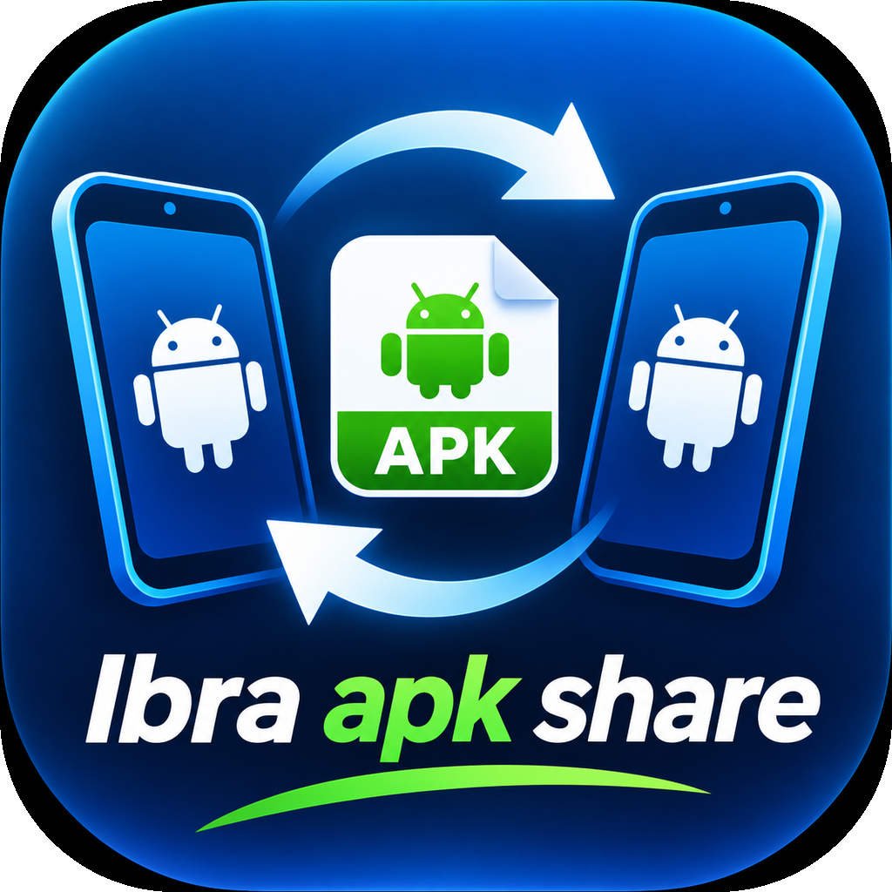

# Ibra APK Share

تطبيق أندرويد لمشاركة وحفظ التطبيقات المثبتة على جهازك كملفات APK.

## المميزات
- عرض كل التطبيقات المثبتة مع الأيقونة والإصدار والحجم
- خيار **إظهار تطبيقات النظام**
- **إرسال APK عبر البلوتوث** مباشرة (تطبيق واحد أو عدة تطبيقات)
- **حفظ APK** في `Download/Ibra APK Share`
- مشاركة عبر أي تطبيق آخر
- دعم التطبيقات المقسّمة (Split APKs) بحفظها كملف `.apks`
- وضع ZIP للأجهزة التي ترفض استقبال APK بالبلوتوث
- بحث وترتيب (الاسم / الحجم / الأحدث) وتحديد متعدد
- يعمل على أندرويد 5.0 فما فوق — بدون إعلانات وبدون أي مكتبات خارجية

## البناء
كل رفع على فرع `main` يبني ملف APK تلقائياً عبر GitHub Actions
(تبويب **Actions** ← آخر تشغيل ← **Artifacts**).
عند رفع وسم مثل `v1.0.0` يُنشر الـ APK في **Releases**.

محلياً: افتح المجلد في Android Studio ثم Build ← Build APK.

---
برمجة وتطوير ابراهيم الخزرجي
- 🌐 https://ibraprogram.netlify.app/
- ✈️ https://t.me/ibraprogram
- 🎵 TikTok: ibraprogram
